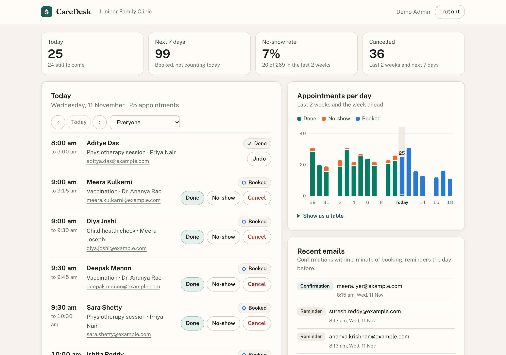
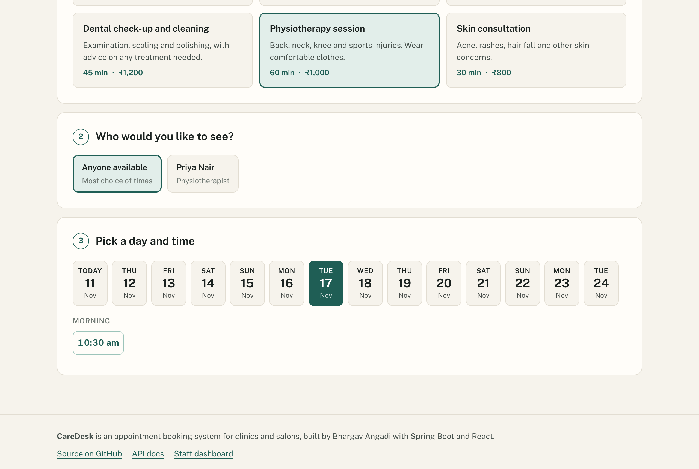
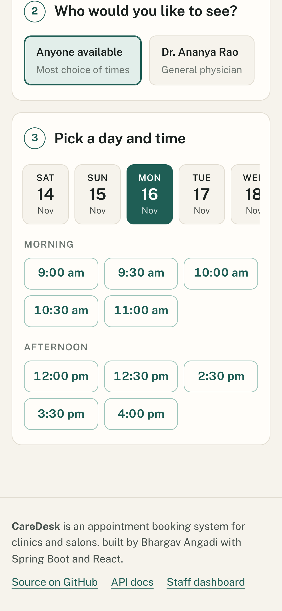

# CareDesk

Online appointment booking for clinics and salons. Customers pick a free time in under a minute, and the front desk runs the day from one screen.

[](https://github.com/bhargavang/caredesk/actions/workflows/ci.yml)

> **This is a portfolio project.** "Juniper Family Clinic" is made up, and every customer you see is generated demo data. There is no live demo yet; you can run it locally in two commands (see below).



## What it does

**For customers** (no account needed)

- Choose a service, then a person or "anyone available", then a day and a time.
- Only free times are shown. They're worked out from each person's working hours, breaks and existing bookings.
- The booking gets a reference like `CD-7KQ2MX`, a confirmation email and a reminder the day before.

**For staff**

- Log in to see today's appointments, filter by person and step through the days.
- Mark appointments done, no-show or cancelled. Cancelling frees the time for someone else straight away.
- A chart of appointments per day for the last two weeks and the week ahead, plus today's count and the no-show rate.
- A log of every confirmation and reminder email.
- Services, staff and weekly working hours are managed through the API (admin role).

| Booking on a laptop | Booking on a phone |
| --- | --- |
|  |  |

There's also a [dark mode screenshot](docs/screenshots/dashboard-dark.png) of the dashboard and one of the [booking page header](docs/screenshots/booking-hero.png).

## How double bookings are stopped

This is the part a booking system can't get wrong, so it's guarded twice:

1. **A locked check.** Booking runs in one transaction that first locks the staff member's row (`SELECT ... FOR UPDATE`), then checks for overlapping appointments. Two people booking the same doctor are handled one after the other, even if they hit different servers.
2. **A database rule.** Every appointment claims its 15-minute blocks in a `booked_block` table with a unique key on (staff, block start). A 45-minute appointment holds three blocks. If anything ever got past the check, the insert fails and the customer sees "that time was just taken" instead of a double booking. Cancelling deletes the blocks, which frees the time.

The tests prove each layer on its own ([DoubleBookingTest](backend/src/test/java/com/bhargavang/caredesk/booking/DoubleBookingTest.java)):

- 12 requests for the same slot fired at the same moment produce exactly one booking.
- Overlapping requests with different start times (09:30 for an hour, 10:00 for half an hour...) produce one booking.
- Inserting straight into the database, skipping the app's check entirely, is still rejected by the unique key.
- Two transactions that both pass the check before either inserts: the unique key stops the second.

CI runs these against PostgreSQL as well as the in-memory database.

## Security

- Passwords are hashed with BCrypt. Only the hash is stored.
- The staff session is a signed JWT in an `HttpOnly`, `Secure`, `SameSite=Strict` cookie scoped to `/api/admin`, so scripts on the page can't read it. API clients (and Swagger) send it as a bearer header instead.
- Writes that rely on the cookie must also carry a custom header that other websites can't add, which blocks cross-site request forgery.
- Logins are rate-limited per IP and per account. Bookings and lookups are rate-limited per IP.
- Content-Security-Policy, `X-Frame-Options`, `Referrer-Policy` and `Permissions-Policy` headers on every response, plus HSTS over HTTPS. Error responses never include stack traces or SQL.
- Prices, availability and permissions are all decided on the server. The frontend holds no secrets.
- Secrets come from environment variables. In production mode the API refuses to start without a proper `JWT_SECRET`.

## Built to scale out

- The API is stateless (no server sessions), so it can run as several instances behind a load balancer and scale up with traffic.
- The booking guard lives in the database, so it holds across all instances.
- The email jobs claim each email with a conditional `UPDATE` before sending, so several instances never send the same email twice. A test runs four job runners at once to check this.
- Java 21 virtual threads for requests, a bounded connection pool, graceful shutdown, and liveness/readiness health checks for the hosting platform.
- The services and staff endpoints send cache headers; built JS, CSS and fonts are cached for a year.
- Rate-limit counters are kept in memory per instance. For a big cluster they'd move to Redis.

## SEO

- The public booking page is rendered to HTML at build time, so search engines and link previews see real content without running JavaScript. React then takes over in the browser.
- Page title, description, canonical URL, Open Graph image, `robots.txt` and a sitemap. Staff pages and booking lookups are marked `noindex`.

## Tech stack

- **Backend:** Java 21, Spring Boot 4.1 (Web MVC, Data JPA, Security with JWT, Validation, Mail, Actuator), Flyway migrations, PostgreSQL in production and H2 for local runs, springdoc OpenAPI, JUnit 5 and MockMvc.
- **Frontend:** React 19, React Router, Vite, hand-written CSS with light and dark themes, and a small SVG chart whose colours are checked for colour-blind readers.
- **Tooling:** GitHub Actions, Docker Compose, nginx.

## Run it locally

You need JDK 21 or newer and Node 20.19 or newer. No database or Docker needed.

**1. Start the API**

```bash
cd backend
./mvnw spring-boot:run
```

It starts on http://localhost:8080 with an in-memory database and about a month of demo appointments around today. The data resets every restart.

**2. Start the website** (in a second terminal)

```bash
cd frontend
npm install
npm run dev
```

Open http://localhost:5173.

- **Staff dashboard:** http://localhost:5173/staff, log in with `demo@caredesk.test` and password `demo1234`.
- **API docs:** http://localhost:8080/swagger-ui.html. To try the staff endpoints, call `POST /api/auth/login`, copy `accessToken`, then click **Authorize**.
- **Emails:** in local mode they're printed in the API's console and shown under "Recent emails" on the dashboard. Set `MAIL_MODE=smtp` and the `SPRING_MAIL_*` variables to send them for real.

If the staff login doesn't stick in Safari, start the API with `COOKIE_SECURE=false`; some browsers won't keep `Secure` cookies on plain `http://localhost`.

## Run it with Docker

```bash
cp .env.example .env
```

Set `JWT_SECRET` and `POSTGRES_PASSWORD` in `.env`, then:

```bash
docker compose up --build
```

Open http://localhost:8081. This runs PostgreSQL, the API and nginx, which serves the prerendered site and passes `/api` through to the API. CI starts this same setup on every push, books a slot, checks that a second attempt gets `409 Conflict`, and logs in.

## Tests

```bash
cd backend
./mvnw test
```

41 tests, including:

- **Free slots:** working hours and breaks, the 30-minute grid, minimum notice, days off, how far ahead you can book, and "anyone available" picking the least busy person.
- **Double bookings:** the concurrency and database tests described above.
- **API and security:** field errors, 409 on a taken slot, 401 without login, the cookie flags, the CSRF header check, admin-only setup changes, security headers.
- **Rate limits:** per IP and per account.
- **Emails:** one confirmation per booking, reminders the day before (but not for bookings made that day), retry after a failed send, no duplicates with several job runners.
- **Demo data:** the seeded clinic loads and the demo password is stored only as a hash.

On every push, GitHub Actions runs the tests on Java 21 with H2 and again on PostgreSQL 17, builds the frontend, and then runs the Docker Compose check.

## Configuration

All settings have local defaults. The ones you'd set when hosting are listed with comments in [`.env.example`](.env.example): database URL and credentials, `JWT_SECRET`, `CORS_ALLOWED_ORIGINS`, `FORWARD_HEADERS_STRATEGY` (set to `framework` behind a trusted proxy so rate limits see the real client IP), mail settings, and `SITE_URL` / `PRERENDER_API_URL` for the frontend build.

## Project layout

```
backend/                     Spring Boot API
  src/main/java/com/bhargavang/caredesk/
    booking/                 free slots, the booking guard, appointments
    catalog/                 services, staff, working hours
    auth/                    login and the session cookie
    notify/                  confirmation and reminder emails, scheduled jobs
    stats/                   appointments per day
    seed/                    the demo clinic
  src/main/resources/db/migration/   database schema (Flyway)
frontend/                    React site and staff dashboard
  scripts/prerender.mjs      renders the home page to HTML at build time
docs/screenshots/            the images in this README
docker-compose.yml
```

## Hosting plan

Not deployed yet. The plan is the API on Render or Railway with `SPRING_PROFILES_ACTIVE=postgres`, a managed PostgreSQL database with automatic backups (Neon or Supabase), and the website on Vercel or Netlify with `/api` forwarded to the API so the login cookie stays first-party. Because the API keeps no state of its own, the host can run two or more instances and add more under load.

---

Built by [Bhargav Angadi](https://bhargavang.github.io/bhargavang/).
